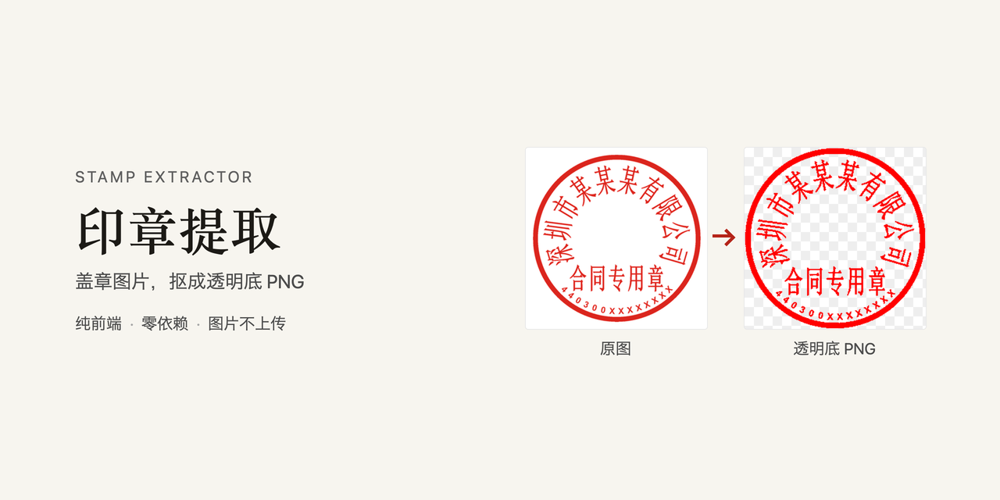
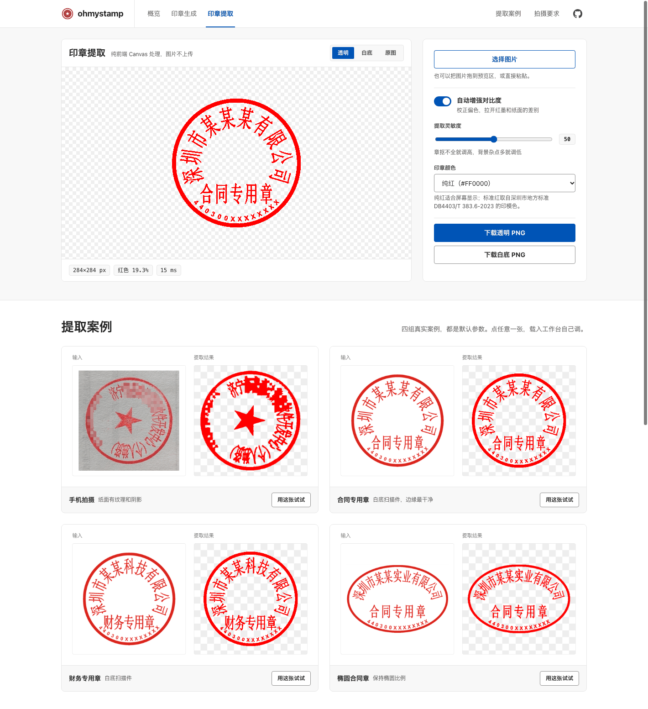
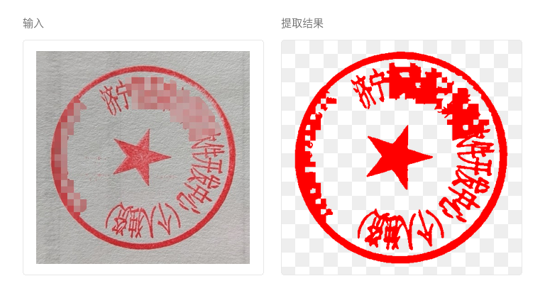
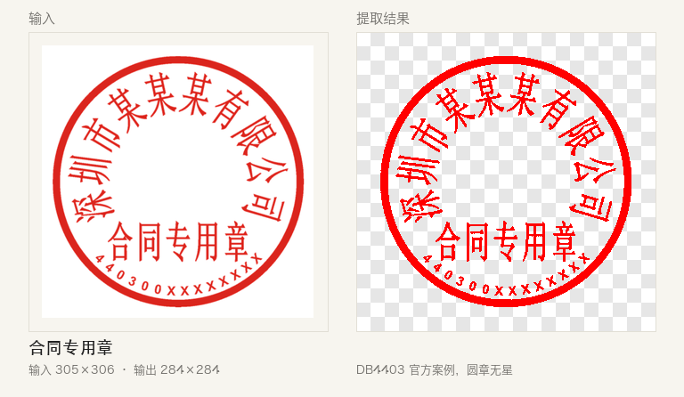
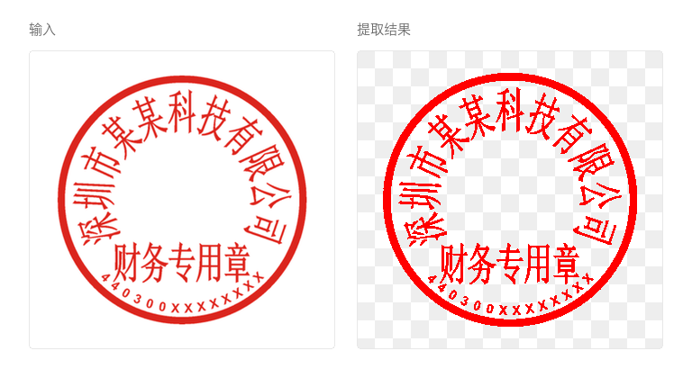
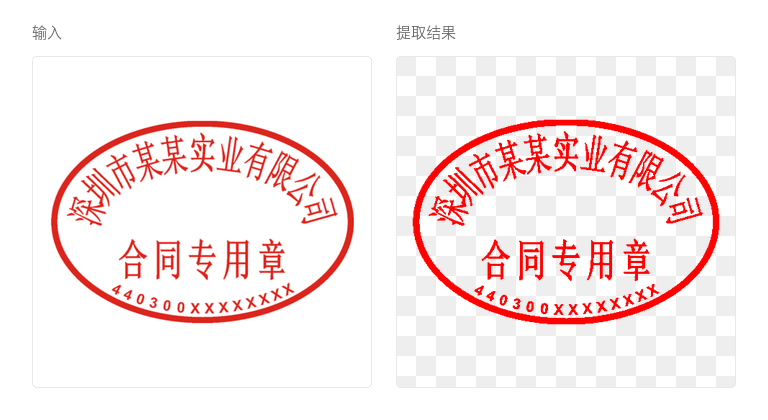

<div align="center">
  

  # 印章提取

  把纸面盖章照片抠成透明底 PNG，纯前端、本地处理，图片不上传。

  
  
  
  

  [快速开始][quick-start] • [选项][options] • [怎么抠的][how] • [案例][cases] • [限制][limits]
</div>

> [!WARNING]
> **合规与法律声明**：本工具仅用于排版研究、内部测试与已有合法印章图像的整理参考，提取的印章图像**不具备任何法律效力**，亦非经公安机关备案的实体印章或符合《中华人民共和国电子签名法》的合法电子印章。依据《中华人民共和国刑法》第二百八十条、《印章治安管理办法》等相关法律法规，严禁使用本工具伪造、变造、盗用国家机关、公司、企业、事业单位或人民团体印章，严禁用于任何未经授权的签署、冒用、欺诈等违法违规行为。章面含公司名和统一社会信用代码等敏感信息，请确认您拥有合法使用权，切勿将导出图上传至公开图床；处理全在浏览器本地完成，不会上传任何图片。一切法律责任由使用者自行承担。



## 快速开始

本地直接双击 `index.html` 即可拖入、选择或粘贴自己的图片（不用构建，断网也能跑）；若要在页面里直接点击「用示例图试试」或下方案例卡片，起一个本地静态服务：

```bash
git clone https://github.com/hey-yx/stamp-extractor.git
cd stamp-extractor
python3 -m http.server 8131
```

打开 <http://127.0.0.1:8131/>，拖入图片、点「选择图片」，或直接 ⌘V 粘贴。

想一步看结果：点预览区里的「用示例图试试」（载入 `cases/02-contract-official/input.png`），预览区下方的状态栏会显示 `284×284 px`。

## 它能做什么

- 从照片里找出红色印章，丢掉纸面，只留章体。
- 纸纹、光照不均、被黑字压断的笔画都能接回来。
- 导出透明底和白底两张 PNG，按章体实际像素裁紧，不补白、不放大。
- 纯静态页面：没有依赖，不用构建，断网也能跑。

## 选项

| 控件 | 默认 | 改的是什么 |
| --- | --- | --- |
| 自动增强对比度 | 开 | 先把偏黄偏灰的纸面校回白色；门槛再放宽 8%，淡墨能多留一些。 |
| 提取灵敏度 | 50 | 调高留更多淡章，调低压掉背景杂点。 |
| 印章颜色 | `#FF0000` | 默认纯红，屏幕显示鲜亮。也可以换标准红 `#DA251D`（深圳市地方标准 DB4403/T 383.6-2023 第 5.3 条的印模色 RGB 218/37/29）。 |

边缘只有「留着」和「全透明」两种，不做柔化，放大后弧线会有台阶。输出两种 PNG，透明底直接拖进 WPS，按实物直径设 4.2cm 或 4.0cm。

## 怎么抠的

1. 先缩到最长边 1800px，大图也不卡页面。
2. 每个像素算一个「有多红」的分值：`(R - (G+B)/2) / (R+G+B)`。白纸接近 0，红墨明显为正，光线亮一点暗一点都影响不大。
3. 定一条线，把像素分成「要」和「不要」，再把靠得近的小块拼回最大的那块，相距不超过短边 4% 就算同一枚。被黑字切断的弧线这样接回来，画面里别的红色标题和 logo 拼不进来。
4. 沿章体边缘裁紧，只留 1px 透明边，章以外全部透明。
5. 导出透明底 PNG，另存一张白底预览。

门槛和各项数值的来历写在 [`docs/算法说明.md`](docs/算法说明.md)。

## 案例

四组都是默认设置：自动增强开、灵敏度 50、纯红。左边输入，右边透明底输出。

<p align="center">
  
</p>
<p align="center">
  
</p>

第一组是真实照片：提取跑的是未打码原图，导出后再把字号和编码打码，所以两边打码位置一致。另外三组来自 DB4403/T 383.6-2023 附录 A，用的是占位名称。逐组说明见 [`cases/README.md`](cases/README.md)。

## 实测结果

四组案例都在 Chrome 里走页面自己的上传流程跑过，导出的 PNG 四角透明，边缘没有半透明像素，只有「留着」和「全透明」两种。

## 限制

- 黑字压在章上的位置会在结果里留缺口。这是纸面遮挡，不做自动补笔。
- 淡到接近纸色、或者小于 300px 的章，边缘会碎，调高灵敏度能多留一些。
- 边缘只有「留着」和「全透明」两种，放大后弧线有台阶。
- 结果是一张图片，不具备法律效力。正式用途要用备案实物章或合规的电子签名平台。

## 文件

- `index.html`、`styles.css`：页面
- `extract.js`：提取算法
- `app.js`：上传、预览、下载
- `cases/`：四组输入、输出和对比图
- `docs/算法说明.md`：门槛、拼块、裁切的实现细节和实测数据

[quick-start]: #快速开始
[options]: #选项
[how]: #怎么抠的
[cases]: #案例
[limits]: #限制
